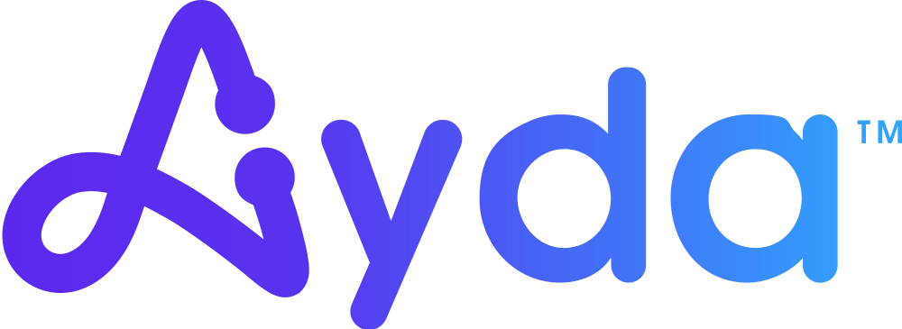

  <picture>
    <source media="(prefers-color-scheme: dark)" srcset="profile/assets/logo-kit/ayda-logo-white.svg" />
    <source media="(prefers-color-scheme: light)" srcset="profile/assets/logo-kit/ayda-logo-full.svg" />
    
  </picture>

  <h1>Ayda organisation profile</h1>

  
<strong>Public GitHub profile and default pull request template for Ayda-Knowledge.</strong>

## Contents

| Path | Holds | Used by |
| --- | --- | --- |
| [`profile/README.md`](profile/README.md) | Public organisation overview | The public `Ayda-Knowledge` GitHub profile page |
| [`profile/assets/`](profile/assets/) | Overview video, preview image, and copied Logo Kit SVGs | The public profile page and this README |
| [`.github/PULL_REQUEST_TEMPLATE.md`](.github/PULL_REQUEST_TEMPLATE.md) | Default pull request sections | New pull requests in `Ayda-Knowledge` repositories without their own template |

## Brand assets

`profile/assets/logo-kit/` holds production SVGs copied from the company brand
Logo Kit with their SHA-256 verification manifest
[`SHA256SUMS`](profile/assets/logo-kit/SHA256SUMS).

| File | Variant | SHA-256 |
| --- | --- | --- |
| `ayda-logo-full.svg` | Colour wordmark for light surfaces | `b0f130c29c4828cbd192369136740525df94eacd1438bc6cfff745601f43d819` |
| `ayda-logo-white.svg` | White wordmark for dark surfaces | `e79d9d661b2df523775a35436a28f46a165275eb7df4648e99100da064ab661a` |
| `ayda-symbol.svg` | Colour A-mark for small icons | `e6388d3ece18e412dd21a4f577af6e7c0753cabf48bb1281c95b2ab390d08a64` |

## Contributing

This repository uses the **profile flow**: open a pull request from a short
branch into `main` and merge with a merge commit. Member-only rules live in
`.github-private`.
