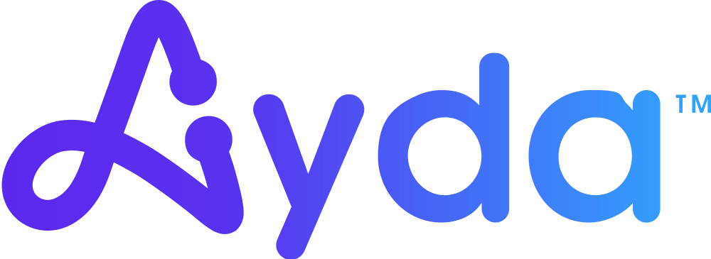
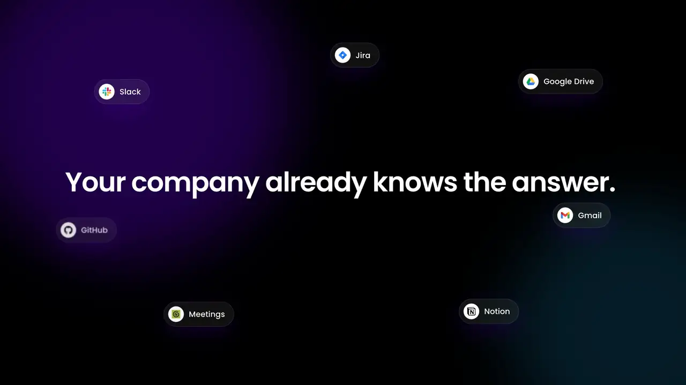

  <picture>
    <source media="(prefers-color-scheme: dark)" srcset="https://raw.githubusercontent.com/Ayda-Knowledge/.github/main/profile/assets/logo-kit/ayda-logo-white.svg" />
    <source media="(prefers-color-scheme: light)" srcset="https://raw.githubusercontent.com/Ayda-Knowledge/.github/main/profile/assets/logo-kit/ayda-logo-full.svg" />
    
  </picture>

<h3 align="center">One live knowledge graph of your company, in your own cloud, with a source for every answer.</h3>

  <a href="https://aydahq.com"><b>aydahq.com</b></a>
  &nbsp;&middot;&nbsp;
  <a href="https://aydahq.com/enterprise-access"><b>Request enterprise access</b></a>
  &nbsp;&middot;&nbsp;
  <a href="https://github.com/Ayda-Knowledge/.github/blob/main/profile/assets/ayda-promo.mp4">Watch the 30-second film</a>

 

Ayda reads the tools your team already uses and builds them into one live
knowledge graph that runs on your own infrastructure. People ask questions in
plain English. Every answer cites the exact thread, email, document or meeting
behind it, and shows each person only what they are permitted to see. Any AI
agent can read the same graph through the Model Context Protocol.

## How it works

| Step | What happens |
| :-- | :-- |
| **1 &nbsp; Connect** | Slack, Google Drive, Gmail, Google Chat, Google Calendar, Google Meet, Granola, Fireflies, GitHub, Notion, Confluence, Jira, Linear, Trello, HubSpot, Attio, Pipedrive, Shopify, WooCommerce, Todoist, web pages, YouTube and document folders. Connectors are read-only: Ayda never writes to your tools. |
| **2 &nbsp; Redact** | Redaction masks secrets and South African identity numbers at ingest. Google Drive content is exempt; names, emails and phone numbers are not masked. |
| **3 &nbsp; Build the graph** | People, projects, decisions and conversations are linked across sources, with one identity for each person. |
| **4 &nbsp; Ask** | Answers come with numbered citations to the source records, in the Ayda app or in the agent you already use. |

## What we hold to

<table>
  <tr>
    <td width="33%" valign="top">
      <b>Runs in your own cloud</b> 
      Each organisation has its own installation. Ayda supports customer-operated installations and installations operated by Ubundi. There is no central control plane.
    </td>
    <td width="33%" valign="top">
      <b>Answers only what each person may see</b> 
      Access is checked on every record before it can reach an answer. The default is deny.
    </td>
    <td width="33%" valign="top">
      <b>Stays yours when the models change</b> 
      Choose from seven language-model providers and eight embedding providers, and change when cost or capability makes sense. Export the graph whenever you want.
    </td>
  </tr>
</table>

## Two editions

**Ayda Enterprise** is for organisations, where not everyone may see
everything: per-person access control, company sign-in with Google or
Microsoft, an audit trail, and installation in your cloud by a named engineer.
[Request enterprise access](https://aydahq.com/enterprise-access). We reply
within one working day.

**Ayda Open Edition** is for one person or a small group that trusts each
other. It is on hold while we focus on Ayda Enterprise.

## Use Ayda from Claude

[**Ayda for Claude**](https://github.com/Ayda-Knowledge/ayda-plugin) is our
open-source plugin. It connects Claude and other skill or MCP agents to your
company's own Ayda and adds skills for cited answers, a daily brief, open
loops, decision traces, fact checks, onboarding briefs and saved Ayda memories.

 

  Your company context is yours to keep.

